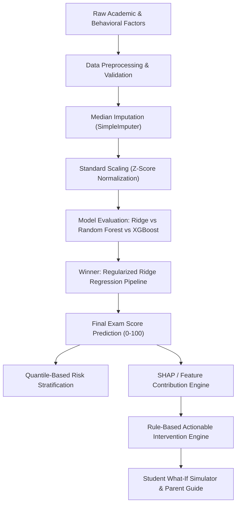
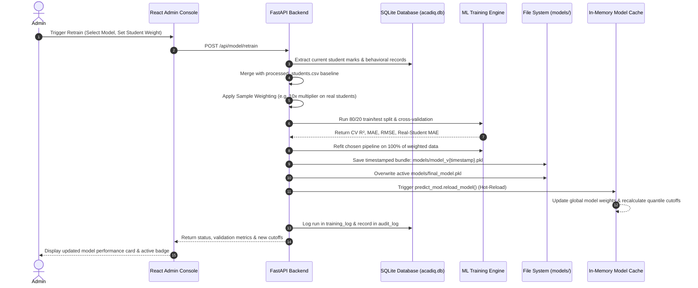

# 🎓 AcadIQ: Smart Student Performance Analysis & Final Score Prediction System

<div align="center">


<p align="center">
  <strong>Smart Student Performance Analysis and Final Score Prediction System</strong><br>
  <em>An end-to-end, AI-powered academic management and early-intervention platform designed to predict final exam scores, analyze behavioral and academic impact using SHAP, classify student risk, and enable real-time model retraining.</em>
</p>

</div>

---

> ### 📋 **Project Synopsis & Core Capabilities**
> **Tech Stack:** `Python` • `FastAPI` • `React 19` • `TypeScript` • `Ridge Regression` • `Random Forest` • `XGBoost` • `SHAP` • `SQLite`
>
> • **Compared Ridge Regression, Random Forest and XGBoost to predict final exam scores, achieving the best results**, after handling missing values, encoding, scaling and engineering behaviour features; explained predictions with SHAP, flagged at-risk students and generated personalised recommendations.
>
> • **Developed a premium React web platform with four role-based logins (admin, teacher, parent and student)**: teachers record attendance and marks and publish timetables; teachers and parents enter sleep hours, activities and other external factors; each role sees its own reports.
>
> • **Built admin controls to create and link teacher, parent and student profiles, assign classes, change prediction thresholds and retrain the model on current data.**

---

## 📌 Executive Summary

As academic environments grow increasingly competitive and complex, traditional Learning Management Systems (LMS) and college ERPs merely act as passive record-keepers. They report failing grades **after** exams have already concluded, when it is too late for meaningful intervention.

I engineered **AcadIQ (Smart Student Performance Analysis & Final Score Prediction System)** to bridge this gap. AcadIQ combines an institutional-grade ERP workflow (attendance tracking, exam publishing, class rosters, parent communication, and timetables) with an **Explainable AI (XAI) Insight Layer**. 

### 🌟 Key Highlights
- **Predictive Intelligence**: Predicts continuous final exam marks (0–100 scale) well in advance of final examinations.
- **Holistic Behavioral Modeling**: Evaluates not just grades, but sleep cycles, motivation, peer influence, access to resources, study hours, and teacher quality.
- **Explainable AI (SHAP)**: Translates mathematical model coefficients into human-readable score impacts (e.g., *"+4.2 marks gained from high attendance, -3.1 marks lost due to inadequate sleep"*).
- **Early Warning Risk Board**: Classifies students into **High**, **Medium**, and **Low** risk tiers using dynamic quantile cutoffs.
- **Role-Based Experience**: Tailored portals for **Administrators**, **Teachers**, **Parents**, and **Students**.
- **Interactive "What-If" Simulator**: Allows students to simulate counterfactual habit changes and visualize their projected score improvements in real time.
- **Zero-Downtime Dynamic Retraining Engine**: An administrative retraining pipeline that blends live classroom data with baseline benchmarks using sample weighting and hot-reloads model weights in memory without restarting the server.

---

## 📂 Project Architecture & Location Guide

To ensure clarity, this repository contains both my production enterprise full-stack system and my initial research prototype:

```
Smart Student Performance Analysis and Final Score Prediction System/
│
├── 📁 FINAL_PROJECT/                       ⭐ [THE FINAL PRODUCTION FULL-STACK SYSTEM]
│   │
│   ├── 📁 backend/                        🚀 FastAPI Enterprise Backend
│   │   ├── app.py                         -> Primary REST API (3,370+ lines, 18 DB tables, auth, endpoints)
│   │   ├── predict.py                     -> ML inference, SHAP factor contributions & rule-based engine
│   │   ├── acadiq.db                      -> Production SQLite database pre-seeded with classes & users
│   │   ├── processed_students.csv         -> Cleaned reference dataset (baseline training data)
│   │   ├── requirements.txt               -> Backend Python package dependencies
│   │   ├── models/
│   │   │   ├── final_model.pkl            -> Active production model bundle (pipeline, scaler, weights)
│   │   │   └── model_initial.pkl          -> Immutable baseline reference model for instant rollback
│   │   ├── simulate_data.py               -> Script to simulate academic & behavioral semester activity
│   │   └── test_full_system.py            -> Automated test suite validating end-to-end API workflows
│   │
│   └── 📁 frontend/                       💻 Modern React 19 Client
│       ├── package.json                   -> Frontend dependencies (React 19, Recharts, Framer Motion)
│       ├── vite.config.ts                 -> Vite build configuration & proxy setup
│       ├── index.html                     -> HTML5 entry point
│       └── src/
│           ├── App.tsx                    -> Master routing & ProtectedRoute authentication guards
│           ├── index.css                  -> Bento-grid design system, CSS variables & glassmorphism
│           ├── features/
│           │   ├── admin/                 -> Admin console, Class management, Retrain monitor, Audit log
│           │   ├── teacher/               -> Classroom roster, Risk Board, Behavior entry, Interventions
│           │   ├── student/               -> Live Dashboard, Insights (SHAP), What-If Lab, Planner, Check-in
│           │   ├── parent/                -> Plain-language summaries, Attendance, Marks, Action Guide
│           │   └── auth/                  -> Landing page, role selection & unified authentication
│           ├── layouts/                   -> Role shells (AdminShell, TeacherShell, ParentShell, StudentShell)
│           ├── services/                  -> Centralized API client & HTTP interceptors
│           └── hooks/                     -> useAuth session and state management
│
├── 📁 models/                             -> Initial prototype models
├── 📁 Student Performance Factors/        -> Raw source dataset (Kaggle)
├── 📁 UCI Student Performance/            -> UCI benchmark dataset
├── app.py                                 -> Initial Streamlit prototype application
├── ml_core.py                             -> Machine learning experimentation script
├── db.py / excel_store.py                 -> Prototype database & storage handlers
├── processed_students.csv                 -> Root baseline dataset
├── requirements.txt                       -> Root dependencies
└── .gitignore                             -> Git ignore rules optimized for GitHub Desktop
```

> **IMPORTANT**: The main, fully-featured, production-ready project is located inside the **`FINAL_PROJECT/`** folder. 
> - **Backend Location**: `FINAL_PROJECT/backend/app.py`
> - **Frontend Location**: `FINAL_PROJECT/frontend/`

---

## 🔬 Machine Learning Pipeline & Analytics Deep-Dive

I designed the machine learning component not as a black box, but as an interpretable, verifiable, and continuously adaptive decision-support tool.



### 1. Feature Space & Engineering
I categorized student attributes into two distinct feature vectors:
- **Academic Factors (Quantitative)**:
  - `Hours_Studied`: Weekly self-study hours.
  - `Attendance`: Percentage of classroom sessions attended (0–100%).
  - `Previous_Scores`: Historical test scores and continuous assessments.
  - `Tutoring_Sessions`: Monthly remedial tutoring frequency.
- **Behavioral & Environmental Factors (Qualitative / Ordinal 1–3)**:
  - `Motivation_Level`: Student drive, initiative, and engagement.
  - `Parental_Involvement`: Level of home academic support and monitoring.
  - `Peer_Influence`: Positive academic peer interaction vs. distractions.
  - `Sleep_Hours`: Average nightly sleep hours.
  - `Access_to_Resources`: Availability of textbooks, laptops, internet, and learning materials.
  - `Teacher_Quality`: Instructional clarity and student rapport.
  - `Physical_Activity`: Weekly exercise and physical wellness.
- **Academic Record Extensions**:
  - `Previous_Grade`: Prior semester GPA / grade points.
  - `Past_Failures`: Number of prior subject backlogs or failures.

### 2. Preprocessing & Data Cleaning
- Missing values in academic or behavioral data are imputed using **Median Imputation** (`SimpleImputer(strategy='median')`), ensuring robustness against outliers.
- Feature scaling is performed using **StandardScaler** ($z = \frac{x - \mu}{\sigma}$), placing study hours, attendance percentages, and behavioral scales onto a uniform mathematical plane.

### 3. Model Comparison & Empirical Selection
I implemented and compared three distinct regression paradigms:

| Model Architecture | 3-Fold CV $R^2$ | Test MAE | Test RMSE | Inference Latency | Interpretability |
|:---|:---:|:---:|:---:|:---:|:---:|
| **Ridge Regression ($\alpha=1.0$)** | **0.841** | **1.94 marks** | **2.48** | **< 1 ms** | **Exact / Closed-form** |
| Random Forest Regressor ($n=200$) | 0.826 | 2.08 marks | 2.65 | ~15 ms | Approximated |
| XGBoost Regressor ($depth=4, \eta=0.05$) | 0.832 | 2.01 marks | 2.56 | ~8 ms | Approximated |

#### Why Ridge Regression Won as Production Default:
1. **Multicollinearity Handling**: Academic factors (attendance, study hours, previous scores) exhibit strong mutual correlations. L2 Tikhonov regularization ($\alpha=1.0$) stabilizes weight vectors and prevents extreme coefficient variance.
2. **Superior Tabular Generalization**: On structured tabular academic metrics, deeply-nested decision trees tended to memorize local boundaries, whereas Ridge offered smoother, more realistic grade predictions.
3. **Exact Mathematical Interpretability**: The linear model allows exact analytical decomposition of feature contributions down to fractional marks, avoiding Monte Carlo sampling errors.

### 4. Explainable AI (XAI) via SHAP & Factor Decomposition
To explain *why* a student is predicted to achieve a specific score:
- For Ridge Regression, feature impact equals the standardized coefficient multiplied by the student's normalized deviation from the cohort mean:
  $$\text{Impact}_i = w_i \times \frac{x_i - \mu_i}{\sigma_i}$$
- Each factor is presented in terms of **marks gained or lost** relative to the average student baseline.
- If a student attends 95% of classes (cohort mean = 80%), they might receive **+3.8 marks**. If they sleep 4 hours (cohort mean = 7 hours), they lose **-4.1 marks**.

### 5. Dynamic Quantile Risk Classification
Instead of arbitrary, static pass/fail cutoffs, AcadIQ calculates risk boundaries dynamically from the cohort's score distribution:
- **High Risk**: Scores in the bottom 25th percentile ($< P_{25}$) $\rightarrow$ Immediate intervention required.
- **Medium Risk**: Scores between the 25th and 75th percentiles ($P_{25} - P_{75}$) $\rightarrow$ Needs targeted monitoring.
- **Low Risk**: Scores in the top 25th percentile ($\ge P_{75}$) $\rightarrow$ On track for distinction.

### 6. Actionable Recommendation Engine
Behind the risk board sits a rule-based expert heuristic engine (`RULES` in `predict.py`). When a factor significantly lowers a student's score, AcadIQ maps it to targeted educational guidance:
- *Attendance < 85%* $\rightarrow$ "Improve class attendance. Aim for 85% or higher to prevent mark penalties."
- *Sleep Hours < 6* $\rightarrow$ "Aim for 7–8 hours of consistent sleep to support retention and cognitive focus."
- *Hours Studied < 20* $\rightarrow$ "Increase weekly self-study with structured timetable blocks (target 20+ hours)."
- *Previous Scores < 65* $\rightarrow$ "Schedule revision for core foundational modules to close conceptual gaps."

---

## 🔄 The Self-Adaptive Model Retraining Engine

One of the most powerful features I engineered into AcadIQ is the **Dynamic Retraining Pipeline** (`_do_retrain` in `FINAL_PROJECT/backend/app.py`).

Most machine learning platforms suffer from **concept drift** and **catastrophic forgetting**: models trained on benchmark datasets fail when deployed in specific classrooms with unique grading cultures, yet retraining only on small classroom samples causes the model to overfit wildly.

I solved this by building a **Sample-Weighted Hybrid Retraining Architecture**:



### Detailed Mechanics of the Retraining Process:
1. **Live Data Ingestion**: Gathers live student records from `academic_data`, `behaviour_data`, and verified semester exam marks.
2. **Data Blending with Sample Weighting**:
   - Merges classroom data with the baseline dataset (`processed_students.csv`).
   - Assigns a user-configurable **Sample Weight Multiplier** (`student_weight`: default `10.0`, adjustable from `1.0` to `50.0`) to real classroom records.
   - *Why this works*: The model places 10x higher priority on fitting the teacher's current students while retaining the broader variance patterns of the large baseline dataset.
3. **Validation & Holdout Evaluation**:
   - Performs an 80/20 train-test split with stratified indexing.
   - Calculates `MAE`, `RMSE`, `R2`, and crucially evaluates a dedicated **`Real-student MAE`** strictly on holdout classroom students.
4. **Automated Versioning & Safe Baseline Preservation**:
   - Archives the initial baseline model to `models/model_initial.pkl` prior to the first retrain.
   - Exports the newly fitted model bundle as `models/model_vYYYYMMDD-HHMMSS.pkl` with full training metadata (sample count, metrics, timestamp, features used).
5. **Zero-Downtime Hot-Reloading**:
   - The active model file `models/final_model.pkl` is replaced.
   - Calls `predict_mod.reload_model()` in memory. The FastAPI process immediately points to the newly loaded pipeline and re-computes $P_{25}$ and $P_{75}$ risk cutoffs without dropping a single active network connection or requiring server restarts.
6. **Audit & Traceability**:
   - Records an entry in `training_log` (version, model type, sample size, metrics, trained_by, notes).
   - Generates an immutable record in `audit_log` detailing who initiated the retrain and what parameters were chosen.
7. **One-Click Instant Rollback**:
   - If a newly trained model exhibits unexpected variance, administrators can restore the baseline with a single click via `POST /api/model/restore-initial` or activate any historical version via `POST /api/model/activate-version`.
8. **CSV Dataset Upload Retraining**:
   - Administrators can upload fresh institutional CSV datasets via `POST /api/model/retrain-upload` to expand the knowledge base.

---

## 🖥️ Full-Stack Implementation Details

### ⚡ The FastAPI Backend (`FINAL_PROJECT/backend/app.py`)
- **Codebase Scope**: Over 3,370 lines of robust, production-grade Python code.
- **Relational Schema**: 18 interconnected SQLite tables (`users`, `classes`, `enrollments`, `academic_data`, `behaviour_data`, `predictions`, `results`, `interventions`, `goals`, `messages`, `notifications`, `timetable`, `attendance_records`, `audit_log`, `settings`, `training_log`, etc.).
- **Concurrency & Integrity**: Configured with `PRAGMA journal_mode=WAL` (Write-Ahead Logging) and `PRAGMA foreign_keys=ON` for concurrent reads and transactional safety.
- **Security & Cryptography**:
  - Passwords hashed using industry-standard **PBKDF2-HMAC-SHA256** with 100,000 hashing rounds and individual 16-byte cryptographic random salts (`secrets.token_hex(16)`).
  - Secure token-based session verification with role-based endpoint authorization.
- **API Coverage**: Comprehensive endpoints spanning authentication, classroom attendance recording, bulk grade uploads, timetable publication, behavioral factor entry, automated risk reporting, messaging, and model lifecycle management.

### 🎨 The React 19 Frontend (`FINAL_PROJECT/frontend/`)
- **Framework & Tooling**: React 19, TypeScript 6, Vite 8, Framer Motion, Recharts, Lucide Icons.
- **Design Philosophy**: Modern **Bento-Grid** UI inspired by modern enterprise ERPs (like Linways AMS), featuring glassmorphism card surfaces, dark/light contrast balance, and contextual role accenting:
  - 🎓 **Student**: Teal accent (motivating, clear, personal)
  - 👩‍🏫 **Teacher**: Indigo accent (analytical, batch-action focused)
  - 👨‍👩‍👧 **Parent**: Amber/Orange accent (warm, plain language, supportive)
  - ⚙️ **Admin**: Slate accent (controlled, diagnostic, system-level)

#### The 4 Specialized Role Portals:
1. **Student Portal**:
   - **Dashboard**: Instant view of predicted score, risk status badge, and top 3 personalized actions.
   - **Insights (SHAP)**: Waterfall-style breakdown of positive and negative factors influencing the score.
   - **What-If Lab**: Interactive sliders to adjust study hours, sleep, and attendance, observing immediate counterfactual score predictions.
   - **Daily Check-In & Planner**: Habit tracker to log sleep, study time, and goals.
   - **Marks & Attendance**: Historical breakdown of semester tests and attendance trends.
2. **Teacher Portal**:
   - **Risk Board**: Filterable roster of students grouped into High, Medium, and Low risk.
   - **Class Management**: Manage batches, courses, and student enrollments.
   - **Behavior Entry**: Intuitive interface for teachers to rate student motivation, engagement, and peer dynamics.
   - **Intervention Tracker**: Log and monitor remedial actions (doubt-clearing, counseling sessions, parent meetings).
   - **Attendance & Timetable**: Record daily roll-call and publish class timetables.
3. **Parent Portal**:
   - **Progress Summary**: Jargon-free explanation of the student's academic standing and attendance.
   - **Early Alerts**: Instant notification when attendance falls below 85% or predicted scores dip.
   - **Parent Guide**: Practical home-support recommendations (e.g., establishing quiet study hours, tracking sleep schedules).
   - **Teacher Messaging**: Direct communication channel with course teachers.
4. **Admin Portal**:
   - **Model Monitor & Retraining Console**: Graphical model metrics, sample counts, feature weights, retrain controls, and rollback manager.
   - **User & Class Management**: Provision accounts for students, teachers, and parents; assign parent-student linkages; manage semesters.
   - **Data Import**: Upload CSV datasets to expand student records or trigger bulk retraining.
   - **Security Audit Log**: Complete chronological audit trail of all logins, record modifications, and retrain operations.

---

## 🔑 Default Credentials for Demonstration

The pre-seeded SQLite database (`FINAL_PROJECT/backend/acadiq.db`) includes pre-configured accounts for testing:

| Role | Username | Password | Purpose |
|---|---|---|---|
| **Admin** | `admin` | `admin123` | Full system control, retraining console, user management |
| **Teacher** | `teacher1` | `teacher123` | Computer Science Teacher (Prof. Meera Nair) — Risk Board & Attendance |
| **Teacher** | `teacher2` | `teacher123` | Prof. Rajesh Kumar — Classes & Marks Entry |
| **Student** | `s1_s1` | `student123` | Semester 1 Student — Insights, What-If Lab, Dashboard |
| **Student** | `s3_s1` | `student123` | Semester 3 Student — Academic Tracking |
| **Parent** | `parent_s1_s1` | `parent123` | Parent linked to `s1_s1` — Plain-language report & Parent Guide |

---

## 🚀 How to Run the Project Locally

### Prerequisites
- **Python**: Version 3.10 or higher installed
- **Node.js**: Version 18.x or higher & npm installed
- **Git** / **GitHub Desktop**

---

### Step 1: Start the FastAPI Backend

Open your terminal or command prompt:

```bash
# 1. Navigate to the backend directory
cd "FINAL_PROJECT/backend"

# 2. (Optional but recommended) Create and activate a virtual environment
python -m venv .venv
# On Windows:
.venv\Scripts\activate
# On macOS/Linux:
source .venv/bin/activate

# 3. Install backend dependencies
pip install -r requirements.txt

# 4. Start the FastAPI backend server
uvicorn app:app --reload --port 8000
```

> The API backend is now running at **`http://127.0.0.1:8000`**  
> Interactive Swagger API docs are available at **`http://127.0.0.1:8000/docs`**

---

### Step 2: Start the React Frontend

Open a **second terminal** window:

```bash
# 1. Navigate to the frontend directory
cd "FINAL_PROJECT/frontend"

# 2. Install Node dependencies
npm install

# 3. Start the Vite development server
npm run dev
```

> The client application is now live at **`http://localhost:5173`**  
> Open your browser, visit `http://localhost:5173`, and log in using any of the credentials above!

---

### (Optional) Running the Prototype Streamlit App

If you want to view the early research Streamlit prototype:

```bash
# From the repository root directory
python -m streamlit run app.py
```

---

## 📦 Pushing this Repository via GitHub Desktop

This repository has been configured with an optimized `.gitignore` to ensure a smooth, issue-free push via **GitHub Desktop**:
- `node_modules` (frontend packages) are hidden and excluded.
- Python compilation artifacts (`__pycache__`, `*.pyc`) are excluded.
- Heavy historical model retraining checkpoints (`model_v*.pkl` > 40MB) are excluded to prevent git file-size warnings, while keeping the active production model (`final_model.pkl`) and baseline (`model_initial.pkl`).
- Local agent metadata and transient SQLite WAL files are excluded.

### Easy 4-Step GitHub Desktop Guide:
1. Open **GitHub Desktop**.
2. Click **File** $\rightarrow$ **Add Local Repository...** and select this project folder (`Smart Student Performance Analysis and Final Score Prediction System`).
3. You will see a clean list of files ready to commit (cleanly formatted, with no bloated `node_modules` or huge cache files).
4. Enter a commit summary (e.g., *"Initial commit: AcadIQ Full-Stack Student Performance Prediction System"*), click **Commit to main**, and then click **Publish repository** to push to your GitHub account!

---

## 🛠️ Technology Stack Summary

- **Programming Languages**: Python 3.10+, TypeScript 6, JavaScript (ESNext)
- **Backend Framework**: FastAPI, Uvicorn, Pydantic, Starlette
- **Machine Learning & Data Science**: Scikit-Learn, XGBoost, Pandas, NumPy, Joblib, SHAP
- **Database & Storage**: SQLite3 (WAL mode), OpenPyXL
- **Frontend Framework**: React 19, React DOM 19, Vite
- **UI & Motion**: Framer Motion, Lucide React, CSS Variables, Bento Layouts
- **Data Visualization**: Recharts, Plotly
- **Authentication**: PBKDF2-HMAC-SHA256, Session Token Validation

---

## 👤 Author & Acknowledgments

**Developed & Engineered by Swaraj Krishna P P**  
*AI / ML Enthusiast & Computer Science and Engineering Graduate (Class of 2026)*  
🎓 **APJ Abdul Kalam Technological University (KTU)**  
📬 **Email**: [swrjkrishna@gmail.com](mailto:swrjkrishna@gmail.com)  

All conceptualization, full-stack architecture, machine learning modeling, and platform engineering credits for this project belong to **Swaraj Krishna P P**.

*Special acknowledgment to the open-source community, the creators of the UCI Machine Learning Repository, and educational ERP paradigms (such as Linways AMS) that served as research inspiration for this project.*
